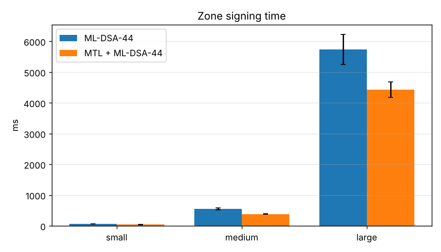
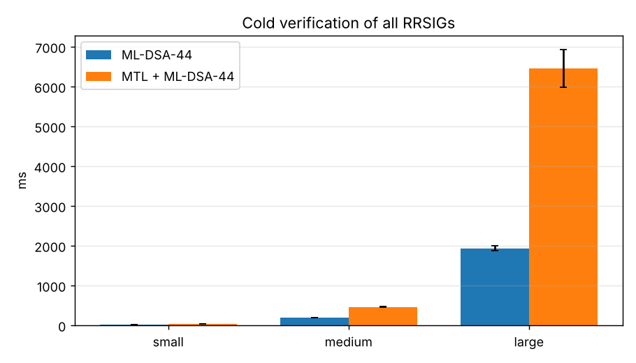
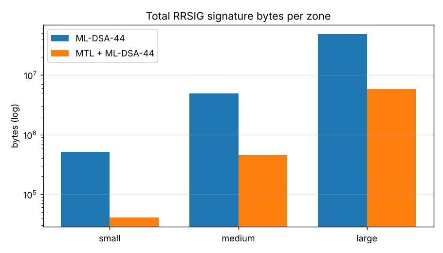
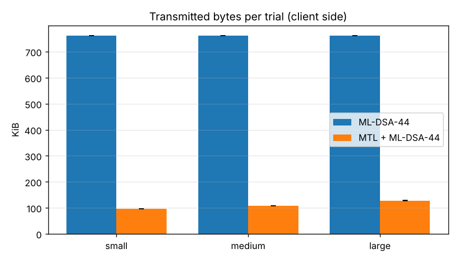
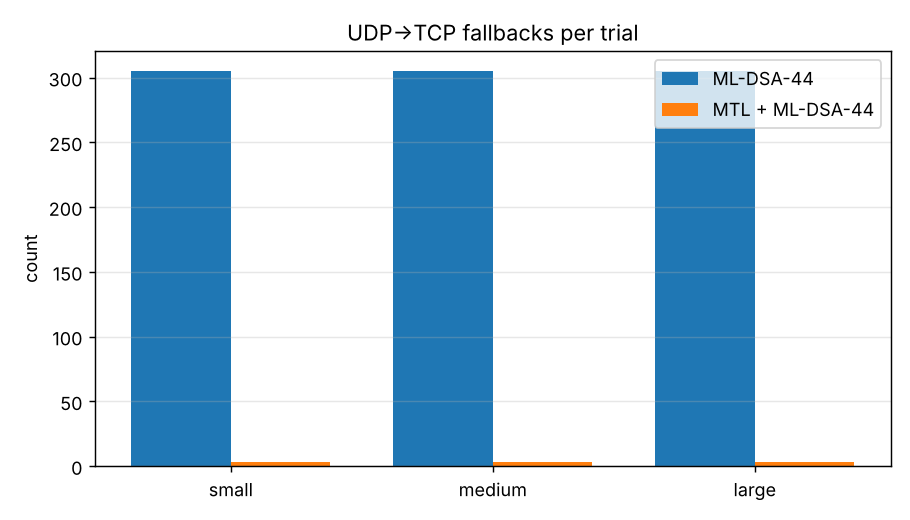
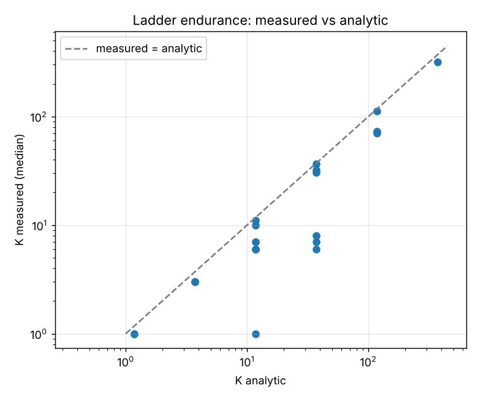

# ABHED-v1: Authenticated Benchmarking of Hybrid Encryption-resistant DNSSEC

## Results Report: ML-DSA-44 vs MTL + ML-DSA-44 for DNSSEC

**Author:** Rajdeep Das, Research Fellow, Institute of Engineering & Management (IEM), Kolkata, India  
**Supported by:** IEM-UEM Group; India Internet Foundation (IIFON); AIORI, Ministry of Electronics and Information Technology (MeitY), Government of India

## 1. Pinned benchmark environment

| Item | Value |
|---|---|
| captured_at_utc | 2026-09-30T04:07:07Z |
| host_os | Kali GNU/Linux Rolling |
| kernel | 6.19.14+kali-amd64 |
| cpu_model | 13th Gen Intel(R) Core(TM) i5-13400 |
| cpu_count | 4 |
| memory_total | 7.7Gi |
| cpu_governor | n/a |
| turbo_disabled_or_boost | n/a |
| docker | 29.8.1 |
| docker_compose | 5.5.1 |
| cpuset_auth | 1 |
| cpuset_resolver | 2 |
| cpuset_client_and_bench | 3 / 3 |
| powerdns_auth | PowerDNS Authoritative Server 5.0.7 (C) PowerDNS.COM BV |
| powerdns_recursor | PowerDNS Recursor 5.3.10 (C) PowerDNS.COM BV |
| pqc_stack | liboqs 0.16.0 liboqs-python 0.16.0.1 dnspython 2.7.0 pycryptodome 3.23.0 cryptography 46.0.6 |
| images | pqcmtl/tools:latest=4cc85c2eff9a pqcmtl/pdns-recursor:rec-53=e9a33b1e5fc0 pqcmtl/pdns-auth:auth-50=77c8cc3717e5  |
| testbed_git_commit | n/a |

## 2. Benchmark configuration and workload parameters

| Parameter | Value |
|---|---|
| PQC signature algorithm | ML-DSA-44 (FIPS 204, liboqs), ZSK only |
| MTL instantiation | ML-DSA-44-MTL-SHAKE-128 (draft-harvey-cfrg-mtl-mode-09, n=16, SID=32 B) |
| KSK | ECDSAP256SHA256 (alg 13, classical) |
| Lab DNSSEC algorithm numbers | 200 = ML-DSA-44, 201 = ML-DSA-44-MTL (lab-only) |
| RRSIG encoding (MTL) | MTL-Type octet (0 condensed / 1 full) + MTL signature (draft-fregly-dnsop-slh-dsa-mtl-dnssec) |
| Signed-ladder retrieval | full signature on `_mtlladder.<zone> TXT` (lab stand-in for the mtl-mode-full EDNS option) |
| Batch signing | one ladder signature per zone signing run |
| Denial of existence | NSEC |
| UDP payload | 1232 B (auth truncation threshold and client EDNS size) |
| Dataset sizes (host RRsets in iem.lab) | {'small': 100, 'medium': 1000, 'large': 10000} |

## 3. Directly measured results

### 3.1 Signing and verification (offline, pinned CPU)

Pinned CPUs: `[3]`. Primitive costs (mean of 500): ML-DSA-44 sign 179.4 µs, verify 62.8 µs; ECDSA P-256 sign 40.4 µs, verify 131.1 µs; MTL cSHAKE128 node hash 17.75 µs.

| Dataset | Mode | RRsets | Zone sign ms (mean±sd) | Cold verify-all ms (mean±sd) | ML-DSA signs | ML-DSA verifies | Mean RRSIG sig bytes | Total RRSIG sig bytes |
|---|---|---|---|---|---|---|---|---|
| small | ML-DSA-44 | 211 | 56.8 ± 1.2 | 20.6 ± 0.4 | 211 | 211 | 2420.0 | 510620 |
| small | MTL + ML-DSA-44 | 213 | 40.6 ± 2.1 | 38.8 ± 0.6 | 1 | 1 | 190.9 | 40653 |
| medium | ML-DSA-44 | 2011 | 555.3 ± 34.9 | 190.9 ± 1.8 | 2011 | 2011 | 2420.0 | 4866620 |
| medium | MTL + ML-DSA-44 | 2013 | 383.9 ± 5.5 | 461.3 ± 4.0 | 1 | 1 | 223.6 | 450101 |
| large | ML-DSA-44 | 20011 | 5736.2 ± 489.2 | 1934.2 ± 57.6 | 20011 | 20011 | 2420.0 | 48426620 |
| large | MTL + ML-DSA-44 | 20013 | 4429.7 ± 245.0 | 6453.8 ± 474.4 | 1 | 1 | 290.6 | 5814821 |

> Implementation note: ML-DSA-44 runs in C (liboqs); the MTL node-set / path hashing is driven from Python (cSHAKE128 via pycryptodome, ~one interpreter round-trip per node hash). Per-RRset MTL time is therefore dominated by interpreter overhead, not by the hash itself. The *operation counts* (1 vs N underlying signatures) are implementation-independent.

### 3.2 Live DNS workload (client -> PowerDNS Recursor -> root / lab / iem.lab)

| Dataset | Mode | Queries/trial x trials | Bytes received / trial (mean±sd) | Mean answer bytes | Answer TCP rate | TCP fallbacks / trial | Ladder fetches / trial | p50 latency ms | Crypto ms / trial | Failures |
|---|---|---|---|---|---|---|---|---|---|---|
| large | ML-DSA-44 | 300 x 5 | 761.7 ± 0.0 KiB | 2521 | 1.00 | 305.0 | 0.0 | 2.76 | 27.9 | 0 |
| medium | ML-DSA-44 | 300 x 5 | 761.7 ± 0.0 KiB | 2521 | 1.00 | 305.0 | 0.0 | 2.62 | 27.3 | 0 |
| small | ML-DSA-44 | 300 x 5 | 761.7 ± 0.0 KiB | 2521 | 1.00 | 305.0 | 0.0 | 2.05 | 28.4 | 0 |
| large | MTL + ML-DSA-44 | 300 x 5 | 128.0 ± 0.3 KiB | 391 | 0.00 | 3.0 | 3.0 | 1.90 | 87.8 | 0 |
| large | MTL + ML-DSA-44 (no ladder cache) | 300 x 5 | 1006.3 ± 0.3 KiB | 391 | 0.00 | 3.0 | 302.0 | 3.22 | 123.5 | 0 |
| medium | MTL + ML-DSA-44 | 300 x 5 | 108.3 ± 0.4 KiB | 323 | 0.00 | 3.0 | 3.0 | 1.72 | 62.9 | 0 |
| medium | MTL + ML-DSA-44 (no ladder cache) | 300 x 5 | 995.6 ± 0.4 KiB | 323 | 0.00 | 3.0 | 302.0 | 3.12 | 102.2 | 0 |
| small | MTL + ML-DSA-44 | 300 x 5 | 95.9 ± 0.3 KiB | 281 | 0.00 | 3.0 | 3.0 | 1.35 | 51.5 | 0 |
| small | MTL + ML-DSA-44 (no ladder cache) | 300 x 5 | 945.5 ± 0.3 KiB | 281 | 0.00 | 3.0 | 302.0 | 2.87 | 86.3 | 0 |

### 3.3 Cache usage - directly measured

Recursor values come from the PowerDNS Recursor statistics API (after a full cache flush at trial start); validator values are the exact serialized sizes of the ladders/keys the validator holds.

| Run | Recursor cache entries (Δ) | Packet-cache entries (Δ) | Recursor RSS Δ (KiB) | Validator ladders | Validator ladder bytes | Validator key bytes |
|---|---|---|---|---|---|---|
| mldsa44_large | 307 | 602 | 74 | 0 | 0 | 4128 |
| mldsa44_medium | 270 | 528 | 254 | 0 | 0 | 4128 |
| mldsa44_small | 107 | 201 | 248 | 0 | 0 | 4128 |
| mtl_large | 310 | 307 | 10 | 3 | 556 | 4128 |
| mtl_large_nocache | 310 | 307 | 8 | 0 | 0 | 4128 |
| mtl_medium | 273 | 270 | 18 | 3 | 588 | 4128 |
| mtl_medium_nocache | 273 | 270 | 18 | 0 | 0 | 4128 |
| mtl_small | 110 | 107 | 14 | 3 | 460 | 4128 |
| mtl_small_nocache | 110 | 107 | 34 | 0 | 0 | 4128 |

> RSS deltas are page-granular and include allocator behaviour; treat them as indicative. Signature-byte cache estimates are in Section 4.2.

## 4. Analytical estimates (kept separate from measurements)

### 4.1 Reference-value endurance and effective signature size (paper Sec. 7.1-7.2)

K_analytic = sqrt(2 ln 2) * sqrt(N0 * rho / alpha);  phi(K,1) = |condensed| + |reference value| / K.
K_measured comes from the real MTL implementation (mtl_rung compatibility checks) over randomised runs.

| N0 | alpha | rho | K measured (median) | K analytic | phi measured B | phi analytic B | ML-DSA-44 B |
|---|---|---|---|---|---|---|---|
| 100 | 10 | 1 | 3.0 | 3.7 | 1025 | 859 | 2420 |
| 100 | 10 | 10 | 6.0 | 11.8 | 599 | 390 | 2420 |
| 100 | 10 | 100 | 8.0 | 37.2 | 492 | 242 | 2420 |
| 100 | 100 | 1 | 1.0 | 1.2 | 2729 | 2344 | 2420 |
| 100 | 100 | 10 | 0.0 | 3.7 | 2729 | 859 | 2420 |
| 100 | 100 | 100 | 1.0 | 11.8 | 2729 | 390 | 2420 |
| 100 | 1000 | 1 | 0.0 | 0.4 | 2729 | 2729 | 2420 |
| 100 | 1000 | 10 | 0.0 | 1.2 | 2729 | 2344 | 2420 |
| 100 | 1000 | 100 | 0.0 | 3.7 | 2729 | 859 | 2420 |
| 1000 | 10 | 1 | 11.0 | 11.8 | 462 | 446 | 2420 |
| 1000 | 10 | 10 | 30.5 | 37.2 | 308 | 292 | 2420 |
| 1000 | 10 | 100 | 70.5 | 117.7 | 259 | 244 | 2420 |
| 1000 | 100 | 1 | 3.0 | 3.7 | 1105 | 933 | 2420 |
| 1000 | 100 | 10 | 6.0 | 11.8 | 663 | 446 | 2420 |
| 1000 | 100 | 100 | 7.0 | 37.2 | 600 | 292 | 2420 |
| 1000 | 1000 | 1 | 1.0 | 1.2 | 2873 | 2473 | 2420 |
| 1000 | 1000 | 10 | 0.0 | 3.7 | 2873 | 933 | 2420 |
| 1000 | 1000 | 100 | 0.0 | 11.8 | 2873 | 446 | 2420 |
| 10000 | 10 | 1 | 36.5 | 37.2 | 357 | 355 | 2420 |
| 10000 | 10 | 10 | 112.5 | 117.7 | 308 | 307 | 2420 |
| 10000 | 10 | 100 | 318.5 | 372.3 | 293 | 292 | 2420 |
| 10000 | 100 | 1 | 10.0 | 11.8 | 547 | 508 | 2420 |
| 10000 | 100 | 10 | 32.0 | 37.2 | 367 | 355 | 2420 |
| 10000 | 100 | 100 | 73.0 | 117.7 | 321 | 307 | 2420 |
| 10000 | 1000 | 1 | 3.0 | 3.7 | 1158 | 989 | 2420 |
| 10000 | 1000 | 10 | 7.0 | 11.8 | 659 | 508 | 2420 |
| 10000 | 1000 | 100 | 6.0 | 37.2 | 722 | 355 | 2420 |

> The approximation assumes N0 >> alpha*rho; rows where alpha*rho approaches N0 are expected to deviate.

### 4.2 Cache footprint of signatures - analytical

Estimated signature bytes a resolver must cache to hold C distinct validated RRsets of the zone (ML-DSA-44: C x 2420; MTL: C x mean condensed size + one signed ladder per zone).

| Dataset | C (distinct RRsets) | ML-DSA-44 bytes | MTL bytes | Reduction |
|---|---|---|---|---|
| small | 100 | 242,000 | 21,706 | 91.0% |
| small | 211 | 510,620 | 42,891 | 91.6% |
| medium | 100 | 242,000 | 25,108 | 89.6% |
| medium | 2011 | 4,866,620 | 452,402 | 90.7% |
| large | 100 | 242,000 | 31,771 | 86.9% |
| large | 20011 | 48,426,620 | 5,816,956 | 88.0% |

## 5. Reproducibility

All numbers in this report are regenerated by `./tb.sh bench-all` (see README). Raw data: `results/crypto/crypto.json`, `results/dns/*/queries.csv`, `results/dns/*/summary.json`, `results/endurance/endurance.json`, `results/env/environment.json`.
